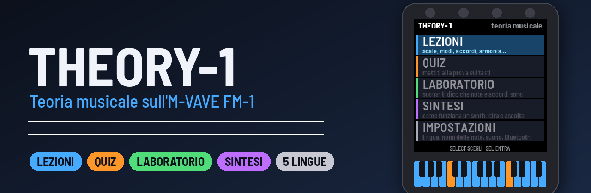
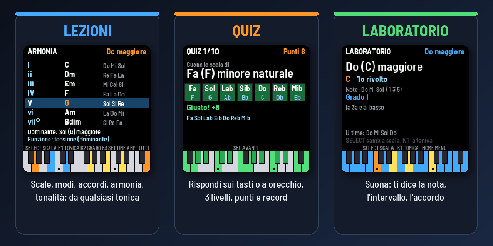
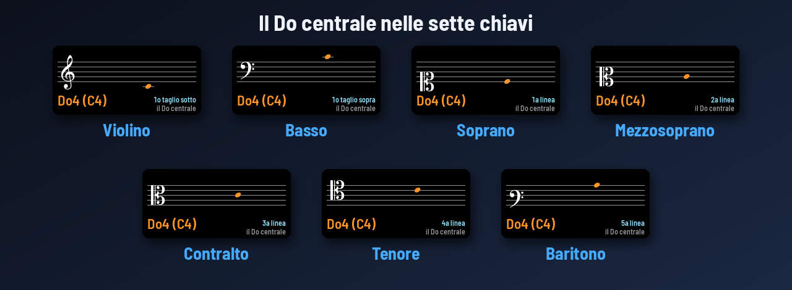
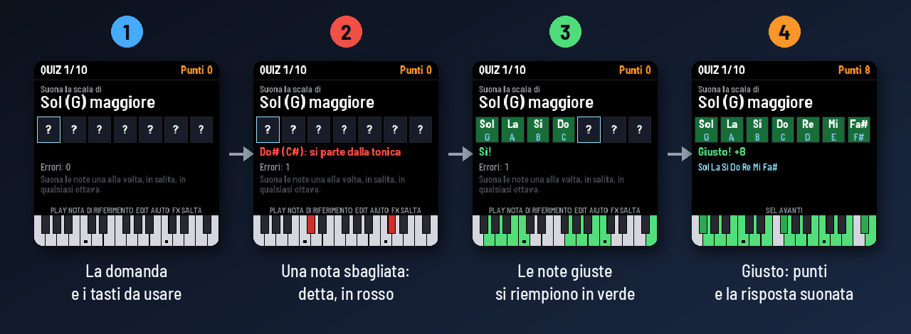
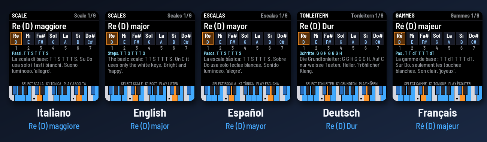
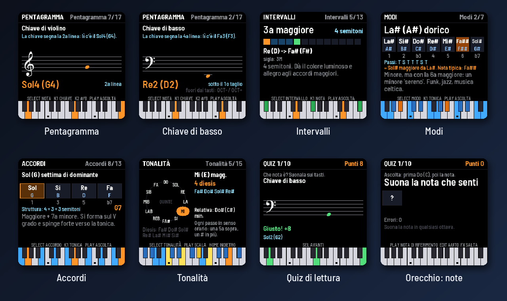

<p align="center"></p>

<p align="center"><i><a href="README.md">English version</a></i></p>

<p align="center"><a href="https://ko-fi.com/wave00066"></a></p>

THEORY-1 è un firmware didattico per l'M-VAVE FM-1. Insegna la teoria musicale a ragazzi e principianti, usando i
tasti, le luci e il display del synth, in **italiano, inglese, spagnolo, tedesco e francese**. Le note sono scritte
come **Do (C)**: nome italiano con la lettera inglese/americana accanto, oppure solo Do Re Mi, solo C D E o alla
tedesca (C D E … H, Fis, Es).

<p align="center"></p>

- **LEZIONI**: le basi, **la lettura delle note sul pentagramma** fino a 7 chiavi, gli intervalli, 9 scale, i 7 modi, 13 tipi di accordo, gli accordi costruiti su ogni grado
  (triadi e settime, con numeri romani e funzione armonica) e il circolo delle quinte con tutte le 15 tonalità.
  Tutto parte da qualsiasi tonica ed è scritto correttamente (Fa maggiore ha il Sib, non il La#).
- **QUIZ**: 11 tipi di domande, da 10 domande ciascuna, su 3 livelli. Si risponde **suonando sui tasti** (note sul
  pentagramma, scale, modi, accordi, intervalli, nomi delle note, gradi). Poi ci sono domande **a orecchio** (note
  singole, intervalli, accordi) e sulle tonalità.
  Ogni risposta riceve un feedback, con aiuti, punteggio e record salvati.
- **LABORATORIO**: suona quello che vuoi e THEORY-1 ti dice che nota, intervallo o accordo è, incluso il rivolto.
  Se scegli una scala, ti mostra i gradi e segnala in rosso le note fuori scala.

I tasti dell'FM-1 si illuminano con le note della lezione: forte la tonica, più tenui le altre note della scala, del
modo o dell'accordo. Quando PLAY suona l'esempio, ogni tasto si accende forte mentre suona la sua nota: vedi la
scala salire e scendere. In basso sul display c'è una tastiera con gli stessi colori (arancio la tonica, verde le
risposte giuste). Funziona anche con una
tastiera MIDI esterna via USB, il jack TRS o il **Bluetooth** (per esempio un piano digitale con Bluetooth MIDI).

## Leggere il pentagramma

<p align="center"></p>

La lezione **Pentagramma** mostra una nota alla volta su un pentagramma vero, con la sua chiave, fino a **due tagli
addizionali** sopra e sotto. Girando SELECT la nota sale e scende. Vedi il nome e l'ottava (Sol4 / G4), la posizione
("2a linea", "1o taglio sotto") e il tasto dell'FM-1 acceso, e **la senti**. K1 cambia chiave, K2 aggiunge diesis o
bemolle. In **IMPOSTAZIONI → Chiavi** scegli quali studiare: **solo violino**, **violino e basso**, oppure **tutte e
sette** (il setticlavio: violino, basso, soprano, mezzosoprano, contralto, tenore, baritono).

Ci sono due quiz collegati:

- **Lettura sul pentagramma**: compare una nota; suonala sui tasti, poi la senti. Livello 1 dentro il pentagramma,
  livello 2 con i tagli addizionali, livello 3 con diesis e bemolli.
- **Orecchio: note**: THEORY-1 suona il Do di riferimento, poi **una nota**; trovala sui tasti. Livello 1 i tasti
  bianchi, livello 2 tutti e dodici, livello 3 due note di fila.

## Una domanda, passo per passo

<p align="center"></p>

Puoi rispondere in qualsiasi ottava, e un accordo puoi suonarlo tutto insieme o una nota alla volta. Una nota
sbagliata viene nominata sul display e si accende in rosso. Dopo 3 errori i tasti giusti si accendono da soli.

## Cinque lingue

<p align="center"></p>

In **IMPOSTAZIONI** (o con GLO da qualsiasi schermata):

- **Lingua**: Italiano, English, Español, Deutsch, Français. Tutto il testo cambia, lezioni comprese. Ogni lingua
  usa i suoi termini (tierce, Große Terz, quinta justa) e i suoi simboli per i passi (T/S, G/H in tedesco, T/dT in
  francese).
- **Nomi delle note**:
  - `Do (C)`: Do Re Mi con le lettere C D E accanto (predefinito). Nei riquadri la lettera compare sotto.
  - `Do Re Mi`: solo il nome italiano (Ré in francese).
  - `C D E`: solo la lettera.
  - `C D E ... H`: alla tedesca, con H per il Si e B per il Sib, Fis/Es per le alterazioni.

Nelle lezioni e nel laboratorio **EDIT** passa al sistema di nomi successivo senza aprire le impostazioni. Le
sigle degli accordi (Cm7, G7, Bm7b5) sono sempre in lettere, come si scrivono sugli spartiti pop e jazz.

## Altre schermate

<p align="center"></p>

## Comandi

| Comando | Cosa fa |
|---|---|
| **SELECT** (encoder) | scorre le voci: pagina, scala, modo, accordo, risposta |
| **SEL** | entra, conferma, risponde, va alla domanda successiva |
| **HOME** | torna indietro di un livello |
| **PLAY** | ascolta l'esempio (nel quiz: la nota di riferimento o di nuovo il suono) |
| **K1** o **PRESETS** | la tonica (nella lezione Pentagramma: la chiave). Nel menu quiz: il livello |
| **K2 / K3** | in Armonia: il grado / triadi o settime. Nella lezione Pentagramma, K2: diesis, bemolle, naturale |
| **ALGORITHM** | nelle lezioni: passa all'argomento successivo |
| **ARP** | in Armonia: suona gli accordi di tutti i gradi |
| **EDIT** | nel quiz: aiuto (si accendono i tasti giusti). Nelle lezioni: il sistema di nomi delle note |
| **FX** | nel quiz: salta la domanda |
| **GLO** | impostazioni |
| **REC** | cerca e collega una tastiera o un piano Bluetooth MIDI (ALGORITHM sceglie, REC collega) |
| **OCT− / OCT+** | spostano di un'ottava il suono dei tasti |

I pulsanti utili nella schermata in cui sei restano accesi tenui.

## Punteggio del quiz

Una risposta giusta al primo colpo vale 10 punti. Ogni nota sbagliata toglie 2 punti e ogni aiuto ne toglie 3, ma
una risposta suonata completa vale sempre almeno 2 punti. Una domanda a scelta vale 10 punti se giusta e 0 se
sbagliata. A fine quiz vedi le stelle e il record. Le risposte con doppi diesis o bemolli non escono mai; Mi#, Si#,
Fab e Dob solo al livello 3.

## Installare

1. Prendi `theory1-X.Y.fwsc` dalle [*Releases*](https://github.com/wave00066/theory1/releases) di questo
   repository, oppure `theory1.fwsc` dall'ultima esecuzione della workflow *Build and attest firmware* in
   **Actions** (artefatto `packages`).
2. Collega l'FM-1 al computer con un cavo USB **dati**, direttamente e senza hub.
3. Da terminale, in una copia di questo repository (`git clone --recursive`):
   ```sh
   pip install mido python-rtmidi
   python3 base/tools/fm1_install.py theory1-X.Y.fwsc
   ```
   L'installer web dell'[FM-1 Firmware Hub](https://thefirmwarehub.com/) installa solo i firmware del suo
   catalogo: THEORY-1 si potrà installare da lì quando sarà nell'elenco.
4. Non staccare il cavo mentre scrive. Alla fine l'FM-1 si riavvia da solo.

**Tornare al firmware ufficiale:** scarica `FM-1.fwsc` (V15) dalla pagina download di M-VAVE e installalo con
M-UPGRADE, con il Firmware Hub o con `fm1_install.py`. Se THEORY-1 non riesce ad
avviarsi due volte di seguito, l'FM-1 entra nella modalità sicura di fm1-base, da cui si può reinstallare qualsiasi
firmware. THEORY-1 scrive solo le sue impostazioni (un settore da 4 KB) e non tocca mai il bootloader. È un firmware
non ufficiale, non ancora provato su ogni esemplare: lo installi a tuo rischio.

## Compilare

Il firmware si compila nel cloud con GitHub Actions, dove si scaricano il compilatore del chip (JieLi) e il suo
SDK. Ogni push su `main` produce `theory1.fwsc` come artefatto, e un tag `vX.Y` crea una release firmata con
`theory1-X.Y.fwsc`.

Sul computer, senza FM-1 né compilatore:

```sh
git clone --recursive https://github.com/wave00066/theory1
sh tests/run_tests.sh          # teoria, tutti i quiz, 13200 domande generate, ogni testo nelle 5 lingue
python3 base/tools/build.py app --host
app/build/host/theory1_host app/tests/screens.txt OUT   # le schermate come PNG
python3 docs/make_graphics.py                            # le immagini di questo README
```

## Struttura

| File | Cosa contiene |
|---|---|
| `app/theory.c` | La teoria: grafia e nomi delle note (Do, Ré, C, H), le sette chiavi, intervalli, scale, modi, accordi, gradi, tonalità e riconoscimento degli accordi, con nomi e spiegazioni nelle 5 lingue. È C puro e si prova da solo. |
| `app/texts.c` | Tutti gli altri testi dello schermo nelle 5 lingue |
| `app/synth.c` | Il suono: un piccolo FM a 2 operatori e 8 voci (pianoforte, piano elettrico, organo, campane) |
| `app/app.c` | Le schermate, il disegno delle lettere accentate, le lezioni, il quiz, il laboratorio, le impostazioni, i tasti e il MIDI |
| `app/staff_glyphs.h` | Le chiavi, la testa della nota, il diesis e il bemolle, dal font musicale [Bravura](https://github.com/steinbergmedia/bravura) (SIL OFL 1.1), fatti da `app/tools/make_glyphs.py` |
| `app/tests/` | `theory_test.c`, `basic.txt` (tutti i quiz, il laboratorio, le impostazioni), `questions.txt` (13200 domande generate e controllate), `texts_fit.txt` (ogni pagina in ogni lingua e ogni chiave entra nello schermo), `screens.txt`, `flow.txt`, `clefs.txt`; `gen_tests.py` scrive i più lunghi |
| `docs/make_graphics.py` | Le immagini del README, fatte dalle schermate del simulatore |
| `base/` | [fm1-base](https://github.com/charlesvestal/fm1-base) (submodule) con [felucca-bsp](https://github.com/hugelton/felucca-bsp) |

I font dell'FM-1 contengono solo ASCII. Le lettere accentate (è, ñ, ü, é, ç) sono la lettera semplice con
l'accento disegnato sopra (o la cediglia sotto), e la ß tedesca è scritta "ss".

## Licenza e crediti

Il codice di THEORY-1 (`app/`, `docs/`, `tests/`) è sotto **Mozilla Public License 2.0** ([`LICENSE`](LICENSE)).
Un pacchetto firmware (`.fwsc`) contiene anche:

| Parte | Di | Licenza |
|---|---|---|
| [fm1-base](https://github.com/charlesvestal/fm1-base) (`base/`) | Charles Vestal e collaboratori | MPL-2.0; alcuni file in `base/ble/` sono `MPL-2.0 AND Apache-2.0` |
| [felucca-bsp](https://github.com/hugelton/felucca-bsp) (`base/bsp/`) | Leo Kuroshita (Hügelton Instruments) e collaboratori | MPL-2.0 (vedi `base/bsp/NOTICE`) |
| Barlow Semi Condensed, il font dello schermo | The Barlow Project Authors | SIL OFL 1.1 ([`LICENSES/OFL-1.1-Barlow.txt`](LICENSES/OFL-1.1-Barlow.txt)) |
| Chiavi, testa della nota, diesis e bemolle (`app/staff_glyphs.h`), da Bravura | Steinberg Media Technologies GmbH | SIL OFL 1.1 ([`LICENSES/OFL-1.1-Bravura.txt`](LICENSES/OFL-1.1-Bravura.txt)) |
| File dell'SDK JieLi AC79 (`uboot.boot`, `cfg_tool.bin`, `eq_cfg_hw.bin`) e librerie Bluetooth (binarie), aggiunti in compilazione | Zhuhai Jieli Technology Co., Ltd. | Apache-2.0 ([`LICENSES/Apache-2.0.txt`](LICENSES/Apache-2.0.txt)) |

Nessun file JieLi è in questo repository: la compilazione li prende dall'SDK. Tutti i dettagli sono in
[`LICENSING.md`](https://github.com/charlesvestal/fm1-base/blob/main/LICENSING.md) e
[`CREDITS.md`](https://github.com/charlesvestal/fm1-base/blob/main/CREDITS.md) di fm1-base.

THEORY-1 non è affiliato né approvato da M-VAVE o JieLi. M-VAVE e FM-1 sono marchi dei rispettivi proprietari.
