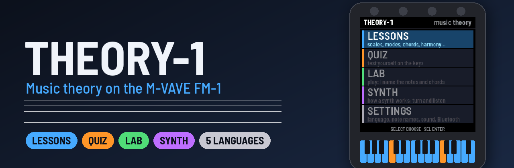
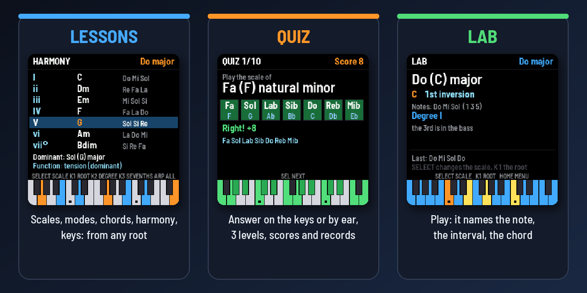
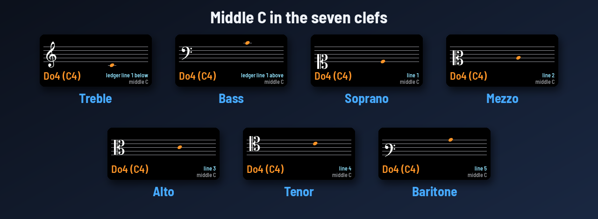
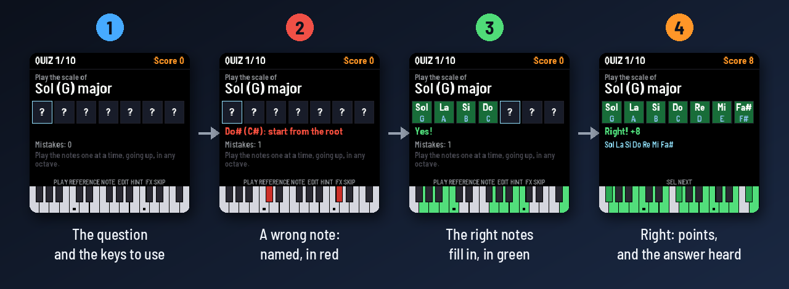
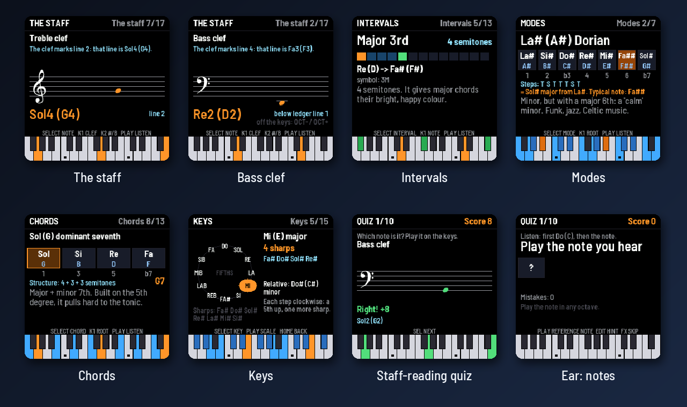

<p align="center"></p>

<p align="center"><i><a href="README.it.md">Versione italiana</a></i></p>

THEORY-1 is a teaching firmware for the M-VAVE FM-1. It teaches music theory to students and beginners through
the synth's keys, lights and screen, in **English, Italian, Spanish, German and French**. Notes can be shown as
**Do (C)** (solfège with the letter beside it), solfège only, letters only, or the German way (C D E … H, Fis, Es).

<p align="center"></p>

- **LESSONS**: the basics, **reading notes on the staff** in up to 7 clefs, intervals, 9 scales, the 7 modes, 13 chord types, the chords built on every degree
  (triads and sevenths, with roman numerals and harmonic function) and the circle of fifths with all 15 keys.
  Everything works from any root and is spelled correctly (F major has Bb, not A#).
- **QUIZ**: 11 kinds of question, 10 questions each, 3 levels. You answer **by playing the keys** (notes on the
  staff, scales, chords, intervals, note names, degrees), **by ear** (single notes, intervals, chords) or by
  choosing (keys). Every answer gets feedback,
  with hints, a score and saved best scores.
- **LAB**: play anything and THEORY-1 names the note, the interval or the chord, with its inversion. Pick a scale
  to see each note's degree, with the notes outside the scale in red.

The FM-1's keys light up with the lesson's notes: orange for the root, the scale's notes, green for right answers.
A keyboard at the bottom of the screen shows the same colours. An outside MIDI keyboard works too, over USB, the
TRS jack or **Bluetooth** (a digital piano with Bluetooth MIDI, say).

## Reading the staff

<p align="center"></p>

The **Staff** lesson shows one note at a time on a real staff, with its clef, up to **two ledger lines** above and
below. Turning SELECT moves the note up and down: its name and octave (Sol4 / G4), its place ("2nd line", "1st
ledger line below") and its key on the FM-1 are shown, and **you hear it**. K1 changes the clef, K2 adds a sharp or a
flat. In **SETTINGS → Clefs** you choose which clefs to study: **treble only**, **treble and bass**, or **all
seven** (the Italian *setticlavio*: treble, bass, soprano, mezzo-soprano, alto, tenor, baritone).

Two quizzes go with it:

- **Staff reading**: a note appears on the staff; play it on the keys, then hear it. Level 1 inside the staff,
  level 2 with the ledger lines, level 3 with sharps and flats.
- **Ear: notes**: THEORY-1 plays the reference C, then **one note**; find it on the keys. Level 1 the white keys,
  level 2 all twelve, level 3 two notes in a row.

## A question, step by step

<p align="center"></p>

You answer in any octave; a chord can be played all at once or one note at a time. A wrong note is named on the
screen and lit red; after 3 mistakes the right keys light up on their own.

## Five languages

<p align="center"></p>

In **SETTINGS** (or GLO from any screen):

- **Language**: Italiano, English, Español, Deutsch, Français. All the text changes, lessons included, with each
  language's own terms (tierce, Große Terz, quinta justa) and steps (T/S, G/H in German, T/dT in French).
- **Note names**:
  - `Do (C)`: solfège with the letters beside it (the default). In the note boxes the letter sits under the name.
  - `Do Re Mi`: solfège only (Ré in French).
  - `C D E`: letters only.
  - `C D E ... H`: the German way, H for B and B for Bb, Fis and Es for the accidentals.

In the lessons and the lab, **EDIT** steps through the naming systems without opening the settings. Chord symbols
(Cm7, G7, Bm7b5) are always in letters, as on pop and jazz charts.

## More screens

<p align="center"></p>

## Controls

| Control | What it does |
|---|---|
| **SELECT** (encoder) | moves through the items: page, scale, mode, chord, answer |
| **SEL** | enters, confirms, answers, goes to the next question |
| **HOME** | goes back one level |
| **PLAY** | plays the example (in the quiz: the reference note, or the sound again) |
| **K1** or **PRESETS** | the root (in the Staff lesson: the clef). In the quiz menu: the level |
| **K2 / K3** | in Harmony: the degree / triads or sevenths. In the Staff lesson, K2: sharp, flat, natural |
| **ALGORITHM** | in the lessons: the next topic |
| **ARP** | in Harmony: plays the chords of every degree |
| **EDIT** | in the quiz: a hint (the right keys light up). In the lessons: the note-name system |
| **FX** | in the quiz: skips the question |
| **GLO** | settings |
| **REC** | looks for a Bluetooth MIDI keyboard or piano and connects to it (ALGORITHM picks, REC connects) |
| **OCT− / OCT+** | move the keys' sound an octave |

The buttons that do something on the current screen glow softly.

## Quiz scoring

A right answer at the first try is worth 10 points. Each wrong note costs 2 and each hint 3, but a complete played
answer is always worth at least 2. A multiple-choice question is worth 10 if right and 0 if wrong. At the end you
get stars and your best score. Answers with double sharps or flats never come up; E#, B#, Fb and Cb only at level 3.

## Install

1. Get `theory1.fwsc` from the latest run of the *Build and attest firmware* workflow in **Actions** (artifact
   `packages`), or from *Releases* when there is one.
2. Connect the FM-1 to a computer with a USB **data** cable, directly, without a hub.
3. Install it with the [FM-1 Firmware Hub](https://thefirmwarehub.com/)'s web installer in Chrome or Edge, or from a
   terminal: `python3 base/tools/fm1_install.py theory1.fwsc`.
4. Don't unplug the cable while it writes.

**Back to the official firmware:** download `FM-1.fwsc` (V15) from M-VAVE's download page and install it with
M-UPGRADE or the installer. If THEORY-1 ever fails to start twice, the FM-1 comes up in fm1-base's safe mode, from
which any firmware can be installed again. This is unofficial firmware: you install it at your own risk.

## Build

The firmware is built in the cloud by GitHub Actions, where the chip's compiler (JieLi) and its SDK are fetched:
every push to `main` builds `theory1.fwsc` as an artifact, and a tag `vX.Y` makes a signed release.

On a computer, with no FM-1 and no compiler:

```sh
git clone --recursive https://github.com/wave00066/theory1
sh tests/run_tests.sh          # the theory, every quiz, 13200 generated questions, every text in 5 languages
python3 base/tools/build.py app --host
app/build/host/theory1_host app/tests/screens.txt OUT   # the screens as PNGs
python3 docs/make_graphics.py                            # this README's pictures
```

## Layout

| File | What it holds |
|---|---|
| `app/theory.c` | The theory: note spelling and names (Do, Ré, C, H), the seven clefs, intervals, scales, modes, chords, degrees, keys and chord recognition, with names and explanations in 5 languages. Plain C, tested on its own. |
| `app/texts.c` | Every other word on the screen, in 5 languages |
| `app/synth.c` | The sound: a small 2-operator FM synth, 8 voices (electric piano, organ, bells) |
| `app/app.c` | The screens, the accented letters, the lessons, the quiz, the lab, the settings, the keys and MIDI |
| `app/staff_glyphs.h` | The clefs, the notehead, the sharp and the flat, from the [Bravura](https://github.com/steinbergmedia/bravura) music font (SIL OFL 1.1), made by `app/tools/make_glyphs.py` |
| `app/tests/` | `theory_test.c`, `basic.txt` (every quiz, the lab, the settings), `questions.txt` (13200 generated questions checked), `texts_fit.txt` (every page in every language, every clef, fits the screen), `screens.txt`, `flow.txt`, `clefs.txt`; `gen_tests.py` writes the long ones |
| `docs/make_graphics.py` | The README's pictures, made from the simulator's screens |
| `base/` | [fm1-base](https://github.com/charlesvestal/fm1-base) (a submodule) with [felucca-bsp](https://github.com/hugelton/felucca-bsp) |

The FM-1's fonts are ASCII only: an accented letter (è, ñ, ü, é, ç) is its plain letter with the accent drawn above
(or the cedilla below), and the German ß is written "ss".

## Licence and credits

MPL-2.0. THEORY-1 is built on Charles Vestal's fm1-base and Leo Kuroshita's (Hügelton Instruments) felucca-bsp. The
staff's symbols come from Bravura by Steinberg Media Technologies (SIL Open Font License 1.1,
`LICENSES/OFL-1.1-Bravura.txt`). It is not affiliated with M-VAVE. M-VAVE and FM-1 are trademarks of their owners.
