# THEORY-1 — music theory on the M-VAVE FM-1

*[Versione italiana](README.it.md)*

THEORY-1 is a teaching firmware for the M-VAVE FM-1. It teaches music theory to students and beginners through
the synth's keys, lights and screen, in **English, Italian, Spanish and German**. Notes can be shown as **Do (C)**
(solfège with the letter beside it), solfège only, letters only, or the German way (C D E … H, Fis, Es).

- **LESSONS**: the basics, intervals, 9 scales, the 7 modes, 13 chord types, the chords built on every degree
  (triads and sevenths, with roman numerals and harmonic function) and the circle of fifths with all 15 keys.
  Everything works from any root and is spelled correctly (F major has Bb, not A#).
- **QUIZ**: 9 kinds of question, 10 questions each, 3 levels. You answer **by playing the keys** (scales, chords,
  intervals, notes, degrees), **by ear** (intervals and chords) or by choosing (keys). Every answer gets feedback,
  with hints, a score and saved best scores.
- **LAB**: play anything and THEORY-1 names the note, the interval or the chord, with its inversion. Pick a scale
  to see each note's degree, with the notes outside the scale in red.

The FM-1's keys light up with the lesson's notes: orange for the root, the scale's notes, green for right answers.
A keyboard at the bottom of the screen shows the same colours. An outside MIDI keyboard works too, over USB, the
TRS jack or **Bluetooth** (a digital piano with Bluetooth MIDI, say).

| | | | |
|---|---|---|---|
| 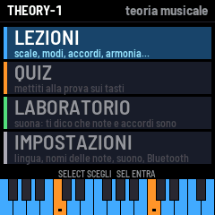 | 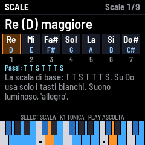 | 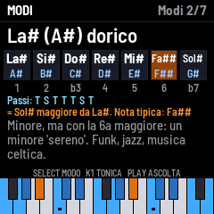 | 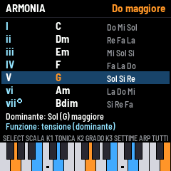 |
| 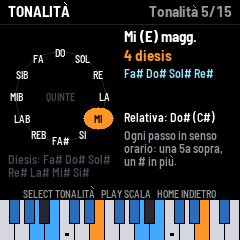 | 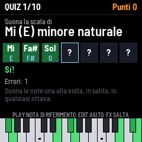 | 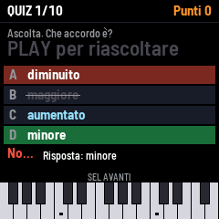 | 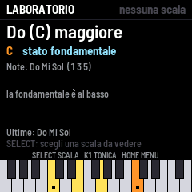 |
| 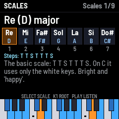 | 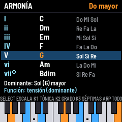 | 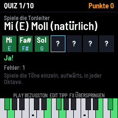 | 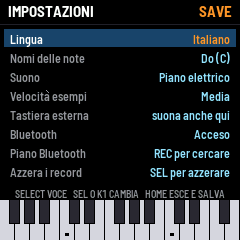 |

## Language and note names

In **SETTINGS** (or GLO from any screen):

- **Language**: Italiano, English, Español, Deutsch. All the text changes, lessons included.
- **Note names**:
  - `Do (C)`: solfège with the letters beside it (the default). In the note boxes the letter sits under the name.
  - `Do Re Mi`: solfège only.
  - `C D E`: letters only.
  - `C D E ... H`: the German way, H for B and B for Bb, Fis and Es for the accidentals.

In the lessons and the lab, **EDIT** steps through the naming systems without opening the settings. Chord symbols
(Cm7, G7, Bm7b5) are always in letters, as on pop and jazz charts.

## Controls

| Control | What it does |
|---|---|
| **SELECT** (encoder) | moves through the items: page, scale, mode, chord, answer |
| **SEL** | enters, confirms, answers, goes to the next question |
| **HOME** | goes back one level |
| **PLAY** | plays the example (in the quiz: the reference note, or the sound again) |
| **K1** or **PRESETS** | the root. In the quiz menu: the level |
| **K2 / K3** | in Harmony: the degree / triads or sevenths |
| **ALGORITHM** | in the lessons: the next topic |
| **ARP** | in Harmony: plays the chords of every degree |
| **EDIT** | in the quiz: a hint (the right keys light up). In the lessons: the note-name system |
| **FX** | in the quiz: skips the question |
| **GLO** | settings |
| **REC** | looks for a Bluetooth MIDI keyboard or piano and connects to it (ALGORITHM picks, REC connects) |
| **OCT− / OCT+** | move the keys' sound an octave |

The buttons that do something on the current screen glow softly. In the quiz only the note names count, so any
octave is right. A chord can be played all at once or one note at a time.

## Quiz scoring

A right answer at the first try is worth 10 points. Each wrong note costs 2 and each hint 3, but a complete played
answer is always worth at least 2. A multiple-choice question is worth 10 if right and 0 if wrong. After 3 mistakes
the right keys light up on their own. At the end you get stars and your best score.

## Install

1. Get `theory1-X.Y.fwsc` from this repository's *Releases*, or from the latest run of the *Build and attest
   firmware* workflow (artifact `packages`).
2. Connect the FM-1 to a computer with a USB **data** cable, directly, without a hub.
3. Install it with the [FM-1 Firmware Hub](https://thefirmwarehub.com/)'s web installer in Chrome or Edge, or from a
   terminal: `python3 base/tools/fm1_install.py theory1-X.Y.fwsc`.
4. Don't unplug the cable while it writes.

**Back to the official firmware:** download `FM-1.fwsc` (V15) from M-VAVE's download page and install it with
M-UPGRADE or the installer. This is unofficial firmware: you install it at your own risk.

## Build

The firmware is built in the cloud by GitHub Actions, where the chip's compiler (JieLi) and its SDK are fetched:

- **Actions → Build and attest firmware → Run workflow**: makes `theory1.fwsc` as an artifact.
- **A tag `vX.Y`** (`git tag v0.1 && git push --tags`): makes a signed release with `theory1-0.1.fwsc`.

On a computer, with no FM-1 and no compiler:

```sh
git clone --recursive https://github.com/wave00066/theory1
sh tests/run_tests.sh          # the theory, the quizzes, the lab, and every text in all 4 languages
python3 base/tools/build.py app --host
app/build/host/theory1_host app/tests/screens.txt OUT   # the screens as PNGs
```

## Layout

| File | What it holds |
|---|---|
| `app/theory.c` | The theory: note spelling and names (Do, C, H), intervals, scales, modes, chords, degrees, keys and chord recognition, with names and explanations in 4 languages. Plain C, tested on its own. |
| `app/texts.c` | Every other word on the screen, in 4 languages |
| `app/synth.c` | The sound: a small 2-operator FM synth, 8 voices (electric piano, organ, bells) |
| `app/app.c` | The screens, the accented letters, the lessons, the quiz, the lab, the settings, the keys and MIDI |
| `app/tests/` | `theory_test.c`, `basic.txt` (every quiz, the lab, the settings), `texts_fit.txt` (every page in every language fits the screen) and `screens.txt` |
| `base/` | [fm1-base](https://github.com/charlesvestal/fm1-base) (a submodule) with [felucca-bsp](https://github.com/hugelton/felucca-bsp) |

The FM-1's fonts are ASCII only: an accented letter (è, ñ, ü, ö) is its plain letter with the accent drawn above,
and the German ß is written "ss".

## Licence and credits

MPL-2.0. THEORY-1 is built on Charles Vestal's fm1-base and Leo Kuroshita's (Hügelton Instruments) felucca-bsp. It
is not affiliated with M-VAVE. M-VAVE and FM-1 are trademarks of their owners.
