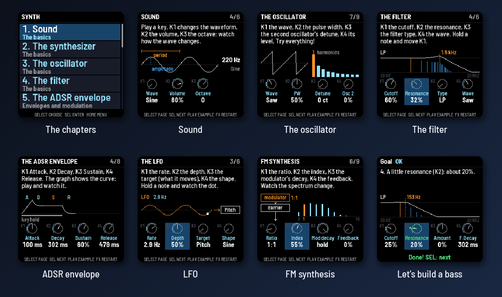
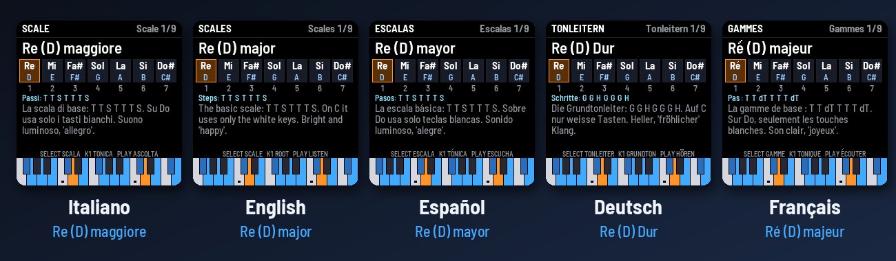

<p align="center"></p>

<p align="center"><i><a href="README.it.md">Versione italiana</a></i></p>

<p align="center"><a href="https://ko-fi.com/wave00066"></a></p>

THEORY-1 is a teaching firmware for the M-VAVE FM-1. It teaches music theory, and how a synthesizer works, to students
and beginners through
the synth's keys, lights and screen, in **English, Italian, Spanish, German and French**. Notes can be shown as
**Do (C)** (solfège with the letter beside it), solfège only, letters only, or the German way (C D E … H, Fis, Es).

<p align="center"></p>

- **LESSONS**: the basics, **reading notes on the staff** in up to 7 clefs, intervals, 9 scales, the 7 modes, 13 chord types, the chords built on every degree
  (triads and sevenths, with roman numerals and harmonic function) and the circle of fifths with all 15 keys.
  Everything works from any root and is spelled correctly (F major has Bb, not A#).
- **QUIZ**: 11 kinds of question, 10 questions each, 3 levels. You answer **by playing the keys** (notes on the
  staff, scales, modes, chords, intervals, note names, degrees), **by ear** (single notes, intervals, chords) or by
  choosing (keys). Every answer gets feedback,
  with hints, a score and saved best scores.
- **LAB**: play anything and THEORY-1 names the note, the interval or the chord, with its inversion. Pick a scale
  to see each note's degree, with the notes outside the scale in red.
- **SYNTH**: how a synthesizer works, in 18 chapters: sound, oscillators, filters, envelopes, the LFO, FM, additive
  and wavetable synthesis, voices and effects, then a bass, a pad, a lead, a stab and drums built step by step. The
  keys play a real teaching synth and K1 to K4 move its knobs, while the screen draws what they do.

The FM-1's keys light up with the lesson's notes: the root bright, the other notes of the scale, mode or chord
softer. When PLAY plays the example, each key lights brightly as its note sounds, so you see the scale go up and down.
A keyboard at the bottom of the screen shows the same in colour (orange the root, green the right answers). An outside MIDI keyboard works too, over USB, the
TRS jack or **Bluetooth** (a digital piano with Bluetooth MIDI, say).

## Reading the staff

<p align="center"></p>

The **Staff** lesson shows one note at a time on a real staff, with its clef, up to **two ledger lines** above and
below. Turning SELECT moves the note up and down: its name and octave (Sol4 / G4), its place ("2nd line", "1st
ledger line below") and its key on the FM-1 are shown, and **you hear it**. K1 changes the clef, K2 adds a sharp or a
flat. In **SETTINGS → Clefs** you choose which clefs to study: **treble only**, **treble and bass**, or **all
seven** (the Italian *setticlavio*: treble, bass, soprano, mezzo-soprano, alto, tenor, baritone).

Two quizzes go with it:

- **Staff reading**: a note appears on the staff; play it on the keys, then hear it. Level 1 inside the staff,
  level 2 with the ledger lines, level 3 with sharps and flats.
- **Ear: notes**: THEORY-1 plays the reference C, then **one note**; find it on the keys. Level 1 the white keys,
  level 2 all twelve, level 3 two notes in a row.

## Learning synthesis

<p align="center"></p>

In **SYNTH** the FM-1 becomes a teaching synthesizer. Its keys play a synth with two oscillators (sine, triangle, saw,
square, pulse, noise), a filter (low-, band- and high-pass, with resonance), an ADSR envelope for the volume and one for
the filter, a pitch envelope, an LFO, two-operator FM, additive and wavetable sources, mono with glide or six voices,
drive and chorus. The 18 chapters follow the path of a synthesis course:

| Part | Chapters |
|---|---|
| The basics | 1 Sound · 2 The synthesizer · 3 The oscillator · 4 The filter |
| Envelopes and modulation | 5 The ADSR envelope · 6 The filter envelope · 7 The pitch envelope · 8 The LFO |
| Synthesis techniques | 9 FM synthesis · 10 Additive and wavetable |
| Voices and effects | 11 Mono, poly and glide · 12 Effects |
| Let's make sounds together | 13 A bass · 14 A pad · 15 A lead · 16 A stab · 17 Drums |
| Your synth | 18 Free synth: every knob, on nine pages |

Each chapter has three kinds of page:

- **read**: a short explanation with a picture: the wave and its harmonics, the block diagram, the filter's curve over
  a saw's harmonics, the ADSR, the LFO, the FM operators and their sidebands, the additive bars, the wavetable.
- **try**: K1 to K4 move four knobs, and the picture follows them while you play.
- **step**: a goal on one knob ("turn K2 until the cutoff reaches 25%"). A mark shows where to go, and when you get
  there the knob turns green: *Done! SEL: next*.

In the chapters of *Let's make sounds together* every step adds one block to the sound, starting from a plain saw, as a
sound designer would. PLAY plays an example that fits the chapter, and FX brings back the chapter's starting sound.

## A question, step by step

<p align="center"></p>

You answer in any octave; a chord can be played all at once or one note at a time. A wrong note is named on the
screen and lit red; after 3 mistakes the right keys light up on their own.

## Five languages

<p align="center"></p>

In **SETTINGS** (or GLO from any screen):

- **Language**: Italiano, English, Español, Deutsch, Français. All the text changes, lessons included, with each
  language's own terms (tierce, Große Terz, quinta justa) and steps (T/S, G/H in German, T/dT in French).
- **Note names**:
  - `Do (C)`: solfège with the letters beside it (the default). In the note boxes the letter sits under the name.
  - `Do Re Mi`: solfège only (Ré in French).
  - `C D E`: letters only.
  - `C D E ... H`: the German way, H for B and B for Bb, Fis and Es for the accidentals.

In the lessons and the lab, **EDIT** steps through the naming systems without opening the settings. Chord symbols
(Cm7, G7, Bm7b5) are always in letters, as on pop and jazz charts.

## More screens

<p align="center"></p>

## Controls

| Control | What it does |
|---|---|
| **SELECT** (encoder) | moves through the items: page, scale, mode, chord, answer (in SYNTH: the page) |
| **SEL** | enters, confirms, answers, goes to the next question |
| **HOME** | goes back one level |
| **PLAY** | plays the example (in the quiz: the reference note, or the sound again) |
| **K1** or **PRESETS** | the root (in the Staff lesson: the clef). In the quiz menu: the level |
| **K2 / K3** | in Harmony: the degree / triads or sevenths. In the Staff lesson, K2: sharp, flat, natural |
| **K1 to K4** | in SYNTH: the four knobs of the page |
| **ALGORITHM** | in the lessons: the next topic |
| **ARP** | in Harmony: plays the chords of every degree |
| **EDIT** | in the quiz: a hint (the right keys light up). In the lessons: the note-name system |
| **FX** | in the quiz: skips the question. In SYNTH: the chapter's starting sound again |
| **GLO** | settings |
| **REC** | looks for a Bluetooth MIDI keyboard or piano and connects to it (ALGORITHM picks, REC connects) |
| **OCT− / OCT+** | move the keys' sound an octave |

The buttons that do something on the current screen glow softly.

## Quiz scoring

A right answer at the first try is worth 10 points. Each wrong note costs 2 and each hint 3, but a complete played
answer is always worth at least 2. A multiple-choice question is worth 10 if right and 0 if wrong. At the end you
get stars and your best score. Answers with double sharps or flats never come up; E#, B#, Fb and Cb only at level 3.

## Install

1. Get `theory1-X.Y.fwsc` from this repository's [*Releases*](https://github.com/wave00066/theory1/releases), or
   `theory1.fwsc` from the latest run of the *Build and attest firmware* workflow in **Actions** (artifact `packages`).
2. Connect the FM-1 to a computer with a USB **data** cable, directly, without a hub.
3. From a terminal, in a copy of this repository (`git clone --recursive`):
   ```sh
   pip install mido python-rtmidi
   python3 base/tools/fm1_install.py theory1-X.Y.fwsc
   ```
   The [FM-1 Firmware Hub](https://thefirmwarehub.com/)'s web installer only installs the firmwares in its own
   catalogue; THEORY-1 can be installed from there once it is listed.
4. Don't unplug the cable while it writes. The FM-1 restarts by itself when it is done.

**Back to the official firmware:** download `FM-1.fwsc` (V15) from M-VAVE's download page and install it with
M-UPGRADE, the Firmware Hub or `fm1_install.py`. If THEORY-1 ever fails to start
twice, the FM-1 comes up in fm1-base's safe mode, from which any firmware can be installed again. THEORY-1 writes
only its own settings (one 4 KB sector) and never touches the bootloader. This is unofficial firmware, not yet tested
on every unit: you install it at your own risk.

## Build

The firmware is built in the cloud by GitHub Actions, where the chip's compiler (JieLi) and its SDK are fetched:
every push to `main` builds `theory1.fwsc` as an artifact, and a tag `vX.Y` makes a signed release with
`theory1-X.Y.fwsc`.

On a computer, with no FM-1 and no compiler:

```sh
git clone --recursive https://github.com/wave00066/theory1
sh tests/run_tests.sh          # the theory, every quiz, 13200 generated questions, every text in 5 languages
python3 base/tools/build.py app --host
app/build/host/theory1_host app/tests/screens.txt OUT   # the screens as PNGs
python3 docs/make_graphics.py                            # this README's pictures
```

## Layout

| File | What it holds |
|---|---|
| `app/theory.c` | The theory: note spelling and names (Do, Ré, C, H), the seven clefs, intervals, scales, modes, chords, degrees, keys and chord recognition, with names and explanations in 5 languages. Plain C, tested on its own. |
| `app/texts.c` | Every other word on the screen, in 5 languages |
| `app/synth.c` | The sound: a small 2-operator FM synth, 8 voices (piano, electric piano, organ, bells), and the SYNTH section's teaching synth (polyBLEP oscillators, state-variable filter, envelopes, LFO, FM, additive, wavetable, drive, chorus; 6 voices) |
| `app/synthmath.h` | The teaching synth's parameters and the curves from a knob to a time, a frequency or a level |
| `app/synthlab.c` | The SYNTH section's screens: the chapters, the pictures, the knobs and the steps |
| `app/synth_lessons.h` | The SYNTH chapters, pages and words in 5 languages, made by `app/tools/gen_synth.py` |
| `app/app.c` | The screens, the accented letters, the lessons, the quiz, the lab, the settings, the keys and MIDI |
| `app/staff_glyphs.h` | The clefs, the notehead, the sharp and the flat, from the [Bravura](https://github.com/steinbergmedia/bravura) music font (SIL OFL 1.1), made by `app/tools/make_glyphs.py` |
| `app/tests/` | `theory_test.c`, `basic.txt` (every quiz, the lab, the settings), `questions.txt` (13200 generated questions checked), `texts_fit.txt` (every page in every language, every clef, fits the screen), `synth.txt` (every SYNTH page in every language, every step's goal), `screens.txt`, `flow.txt`, `clefs.txt`; `gen_tests.py` writes the long ones |
| `docs/make_graphics.py` | The README's pictures, made from the simulator's screens |
| `base/` | [fm1-base](https://github.com/charlesvestal/fm1-base) (a submodule) with [felucca-bsp](https://github.com/hugelton/felucca-bsp) |

The FM-1's fonts are ASCII only: an accented letter (è, ñ, ü, é, ç) is its plain letter with the accent drawn above
(or the cedilla below), and the German ß is written "ss".

## Licence and credits

THEORY-1's own code (`app/`, `docs/`, `tests/`) is under the **Mozilla Public License 2.0** ([`LICENSE`](LICENSE)).
A firmware package (`.fwsc`) also contains:

| Part | By | Licence |
|---|---|---|
| [fm1-base](https://github.com/charlesvestal/fm1-base) (`base/`) | Charles Vestal and contributors | MPL-2.0; a few files in `base/ble/` are `MPL-2.0 AND Apache-2.0` |
| [felucca-bsp](https://github.com/hugelton/felucca-bsp) (`base/bsp/`) | Leo Kuroshita (Hügelton Instruments) and contributors | MPL-2.0 (see `base/bsp/NOTICE`) |
| Barlow Semi Condensed, the screen's font | The Barlow Project Authors | SIL OFL 1.1 ([`LICENSES/OFL-1.1-Barlow.txt`](LICENSES/OFL-1.1-Barlow.txt)) |
| The clefs, notehead, sharp and flat (`app/staff_glyphs.h`), from Bravura | Steinberg Media Technologies GmbH | SIL OFL 1.1 ([`LICENSES/OFL-1.1-Bravura.txt`](LICENSES/OFL-1.1-Bravura.txt)) |
| JieLi AC79 SDK files (`uboot.boot`, `cfg_tool.bin`, `eq_cfg_hw.bin`) and Bluetooth libraries (binary), added at build time | Zhuhai Jieli Technology Co., Ltd. | Apache-2.0 ([`LICENSES/Apache-2.0.txt`](LICENSES/Apache-2.0.txt)) |

None of the JieLi files is in this repository: the build fetches them from the SDK. The full details are in
fm1-base's [`LICENSING.md`](https://github.com/charlesvestal/fm1-base/blob/main/LICENSING.md) and
[`CREDITS.md`](https://github.com/charlesvestal/fm1-base/blob/main/CREDITS.md).

THEORY-1 is not affiliated with or endorsed by M-VAVE or JieLi. M-VAVE and FM-1 are trademarks of their owners.
